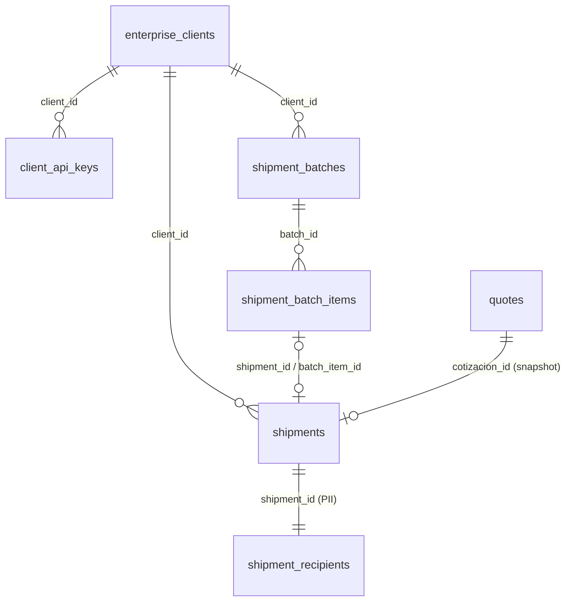

# Envíos masivos B2B: P0 (contrato 1.3.0)

Módulo que permite a clientes empresariales autenticados crear muchos envíos en una sola solicitud.
Procesa cada envío por separado, es idempotente y aísla los datos por cliente. Este documento explica
qué hay, cómo se opera y qué falta. El contrato campo a campo está en `contracts/openapi.yaml`
(tag *envíos masivos*) y las decisiones, en `contracts/DECISIONS.md` §5 (DEC-SHP1 a DEC-SHP11).

## 1. Estado

| Funcionalidad | Estado |
|---|---|
| Autenticación por API key (`Authorization: Bearer`), scopes y aislamiento por cliente | Implementado y probado |
| `POST /api/v1/shipment-batches`: lote JSON, procesamiento parcial e idempotente | Implementado y probado |
| `GET /api/v1/shipment-batches/{id}` y `GET …/{id}/items` (paginado por cursor) | Implementado y probado |
| Envío + destinatario + guía de la secuencia PostgreSQL, atómicos por ítem | Implementado y probado |
| Precio congelado con `QuotationService` (fórmula, versión de tarifa, fecha) | Implementado y probado |
| Reanudación de ítems `PENDING` con una repetición idéntica (sin worker) | Implementado y probado |
| Auditoría B2B (`api_audit_events`) y rate limit por cliente | Implementado y probado |
| Alta de clientes y keys por CLI | Implementado y probado manualmente |
| CSV/Excel, worker asíncrono, webhooks, TMS real, tracking de guías internas | **Fuera de P0** |

## 2. Puesta en marcha

```bash
cd backend
uv run alembic upgrade head          # crea las tablas y la secuencia (0002) y lo posterior
# Reinicia uvicorn: un servidor arrancado antes de este módulo no tiene las rutas y responde 404.
uv run uvicorn app.main:app --host 127.0.0.1 --port 8000
uv run python -m app.clients.cli create-client --nit 900123456-7 --razon-social "Cliente Demo"
uv run python -m app.clients.cli create-key --client-id <client_id> \
  --scope batches:create --scope batches:read
```

- `create-key` imprime la API key completa **una sola vez**; solo se guarda su SHA-256.
- Otros comandos: `show --client-id`, `revoke-key --key-id` y `set-status --client-id --estado INACTIVE`.
- La migración 0002 se verificó así:
  - sobre una base limpia: upgrade, `alembic check`, downgrade y upgrade de nuevo;
  - sobre una copia de la base existente, con los datos idénticos antes y después.
- Para comprobar que el servidor tiene el módulo, `curl -s localhost:8000/openapi.json` debe listar
  `/api/v1/shipment-batches`.
- Una ruta que existe, llamada sin API key, responde **401** `NO_AUTENTICADO`. Si
  `POST /api/v1/shipment-batches` responde **404** `NO_ENCONTRADO`, el servidor corre código anterior
  al módulo y hay que reiniciarlo.

## 3. Autenticación

| Situación | Respuesta |
|---|---|
| Sin header, key malformada, desconocida o revocada | 401 `NO_AUTENTICADO` (el mismo para todos los casos) |
| Cliente `INACTIVE`, o key sin el scope requerido | 403 `NO_AUTORIZADO` |

Scopes requeridos: `batches:create` para el POST y `batches:read` para los GET. El `client_id` sale
siempre de la credencial, nunca del cuerpo. Un lote de otro cliente responde 404, como si no existiera.

## 4. Crear un lote

```bash
# desde la raíz del repositorio (la ruta del ejemplo es relativa a ella)
curl -s -X POST http://localhost:8000/api/v1/shipment-batches \
  -H "Authorization: Bearer $API_KEY" -H "Idempotency-Key: LOTE-CLIENTE-0001" \
  -H "Content-Type: application/json" -d @contracts/examples/shipment-batch.request.json
```

Cada envío usa los mismos campos que `POST /cotizar`: `origen`, `destino`, `alto_cm`, `ancho_cm`,
`largo_cm`, `peso_real_kg`, `valor_declarado_cop`, `requiere_cadena_frio` y `mercancia_peligrosa`.
Además lleva `referencia_cliente` y `destinatario` (`nombre`, `telefono` y `direccion`, obligatorios;
documento y `email`, opcionales). Respuesta del ejemplo: 1 creado y 2 rechazados
(`contracts/examples/shipment-batch.response.json`).

| HTTP | Cuándo |
|---|---|
| 201 | Lote nuevo, procesado |
| 200 | Repetición con la misma `referencia_lote` y el mismo contenido. Si el lote quedó a medias y su lease venció, también reanuda los ítems pendientes |
| 202 | El mismo lote se está procesando en otra solicitud (lease vivo) |
| 409 `IDEMPOTENCIA_CONFLICTO` | Misma `referencia_lote` con contenido distinto |
| 413 `LOTE_DEMASIADO_GRANDE` | Más de `BATCH_MAX_ITEMS` envíos o más de `BATCH_MAX_BODY_BYTES` |
| 422 `VALIDACION` | Estructura del lote inválida: JSON mal formado, falta `referencia_lote`, `envios` vacío, o `Idempotency-Key` distinto de `referencia_lote` |
| 429 `LIMITE_DE_TASA` | Más de `BATCH_RATE_LIMIT_PER_MINUTE` lotes por minuto del mismo cliente |

Un envío inválido **no** invalida el lote: queda `REJECTED` con `errores: [{code, field}]` y los
demás siguen.

| Código de ítem | Causa |
|---|---|
| `VALIDACION` | Campo inválido; `field` indica la ruta, p. ej. `destinatario.telefono` |
| `REFERENCIA_DUPLICADA` | La referencia se repite en el lote (después de su primera línea) o ya se usó en un lote anterior |
| `CIUDAD_NO_RECONOCIDA` | La ciudad no está en el directorio |
| `CIUDAD_NO_CUBIERTA` | Ciudad reconocida sin cobertura operativa |
| `TARIFA_NO_DISPONIBLE` | No hay tarifa para la ruta (p. ej. Bogotá → Envigado) |
| `SERVICIO_NO_DISPONIBLE` | Cadena de frío hacia un destino sin servicio refrigerado |
| `ERROR_INTERNO` | Falló la persistencia de ese ítem; solo ese ítem se revierte |

Los errores llevan código y campo, **nunca el valor enviado**.

## 5. Consultar

```bash
curl -s http://localhost:8000/api/v1/shipment-batches/$LOTE_ID -H "Authorization: Bearer $API_KEY"
curl -s "http://localhost:8000/api/v1/shipment-batches/$LOTE_ID/items?status=REJECTED&limit=50" \
  -H "Authorization: Bearer $API_KEY"
```

`items` se ordena por `linea`. Para la página siguiente se envía el `next_cursor` recibido como
`cursor`; un cursor inválido responde 422. `limit` va de 1 a 200.

## 6. Transacciones y consistencia

1. La cabecera y todas las líneas se confirman como `PENDING` antes de procesar.
2. Cada ítem va en su propia transacción. Ahí se toma la guía (`nextval`), se guardan la cotización,
   el envío y el destinatario, y se marca el ítem `CREATED`. O todo o nada.
3. Si un ítem falla, solo ese ítem se revierte. La guía consumida no queda asignada a nada: la secuencia
   admite huecos.
4. La idempotencia y las referencias duplicadas las garantizan las restricciones `UNIQUE` de PostgreSQL;
   las comprobaciones en código solo son la primera barrera.
5. No hay worker. El lease (`locked_until`, `BATCH_LEASE_SECONDS`) se renueva en cada ítem; si el proceso
   se interrumpe, los ítems quedan `PENDING`. Una repetición idéntica después de que venza el lease los
   reanuda, sin recrear los que ya están `CREATED` o `REJECTED`. El lote no guarda el cuerpo enviado,
   porque contiene PII.

## 7. Modelo de datos (migración 0002)



| Restricción | Garantiza |
|---|---|
| `UNIQUE(client_id, referencia_lote)` en `shipment_batches` | Idempotencia del lote |
| `UNIQUE(batch_id, line_number)` en `shipment_batch_items` | Una fila por línea |
| `UNIQUE(numero_guia)` y `UNIQUE(client_id, referencia_cliente)` en `shipments` | Guías únicas y referencias no repetidas |
| `UNIQUE(shipment_id)` en `shipment_recipients` | Un destinatario por envío |
| Secuencia `shipment_guide_seq` 200000–299999 | Guías sin cruzarse con el dataset |

La auditoría (`api_audit_events`) es una tabla aparte, solo de inserción, sin cuerpos ni PII.

## 8. Pruebas

```bash
cd backend && uv run pytest -q tests/shipments     # 34 pruebas del módulo (la suite completa: uv run pytest)
```

- **`tests/shipments/test_domain.py`** (17 pruebas, sin base de datos): keys, NIT, formato y rango de
  guía, parseo por ítem sin valores en los errores, duplicados, hash canónico, cursor, y validación y
  cotización con los datos reales.
- **`tests/shipments/test_batches_api.py`** (17 pruebas, PostgreSQL `translogix_test` por HTTP):
  - autenticación válida, inválida, revocada, sin scope e inactiva;
  - aislamiento entre clientes;
  - procesamiento parcial;
  - snapshot de precio;
  - rollback de un ítem sin afectar a los demás (envío y destinatario atómicos);
  - referencias duplicadas entre lotes;
  - repetición idempotente y conflicto 409;
  - idempotencia y unicidad de guías bajo concurrencia;
  - reanudación tras una interrupción;
  - límites 413 y 422, y rate limit 429;
  - paginación;
  - ausencia de PII en respuestas, logs, auditoría y tablas;
  - OpenAPI real igual al contrato.
- Las pruebas con base de datos usan `TEST_DATABASE_URL`; sin PostgreSQL se omiten y lo indican.

## 9. Pendiente (decisiones de negocio, spec §14) y limitaciones

- ¿`provisional-v1` sirve para crear envíos comerciales o solo para simular? Hoy se crea con ese precio
  congelado (DEC-SHP6).
- Estados después de `REGISTRADO`, y qué significa "confirmado para despacho" (DEC-SHP5).
- Límites de peso, dimensiones, valor declarado e ítems por lote. Hoy el peso sobre el máximo solo se
  advierte (DEC-Q4), el valor no tiene tope y hay un máximo de 500 ítems configurable.
- Mercancía peligrosa: falta una política determinista; hoy no se valida la clase (DEC-SHP7).
- Campos obligatorios del destinatario, y cifrado, retención y eliminación de su PII. Hoy se guarda en
  claro en `shipment_recipients` (DEC-SHP9). **Bloquea producción.**
- Unicidad permanente de `referencia_cliente` (DEC-SHP3).
- **Limitaciones técnicas:**
  - capacidad de 100.000 guías con el formato actual (DEC-SHP1);
  - las guías internas no se consultan en `/tracking` (DEC-SHP8);
  - el rate limit vive en memoria, por proceso;
  - un lote grande se procesa dentro de la petición: el asíncrono es P1.
