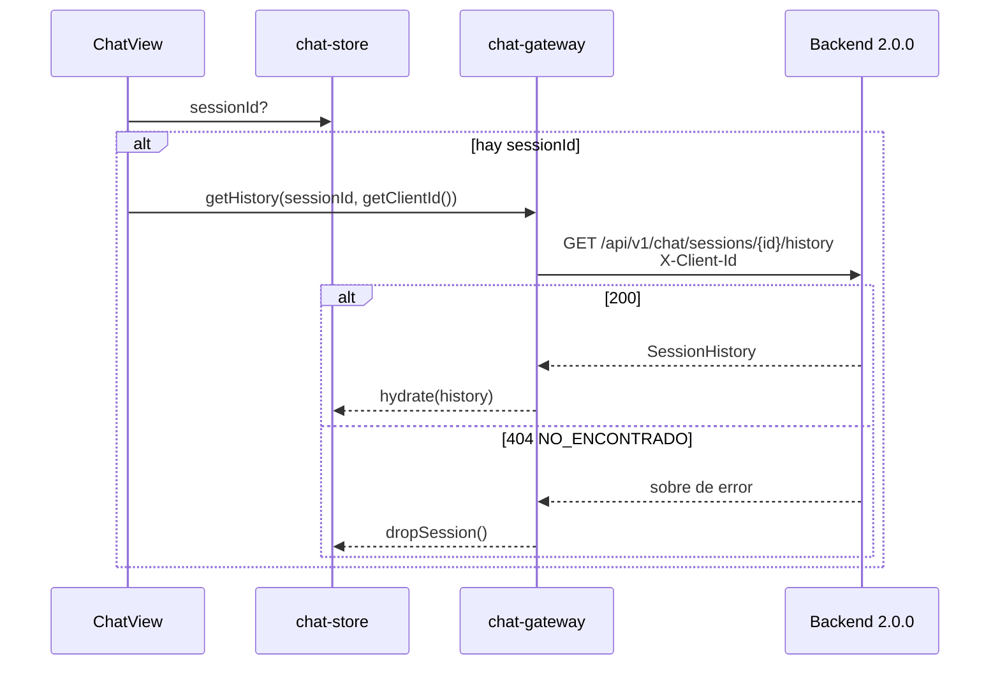

# 01 — Historial del chat

| | |
|---|---|
| Frontend | `AnthonyCod/front-kodotakai@0d09a44` (`main`) |
| Backend | 2.0.0 (`feef68d`) |
| Rutas | Las del frontend son relativas a su raíz; las del backend, a `backend/` |

## A. Estado actual del frontend

| Pieza | Archivo y líneas | Qué hace |
|---|---|---|
| Identidad del navegador | `src/features/chat/model/client-id.ts:9-21` (`getClientId`) | UUID v4 en `localStorage['tlx.client_id']`; si el almacenamiento falla, en memoria |
| Chat nuevo | `client-id.ts:27-36` (`rotateClientId`); `chat-store.ts:162-165` (`startNewChat`) | Cambia el `client_id` para no reutilizar la última sesión abierta |
| Cliente HTTP del historial | `src/features/chat/api/chat-gateway.tsx:21-29` (`getHistory`) | `GET /chat/sessions/{id}/history` con `X-Client-Id` |
| Schema Zod | `src/features/chat/api/chat-contract.ts:62-75` (`historyEntrySchema`, `sessionHistorySchema`) | `message_id`, `direction`, `text`, `blocks` y `created_at` |
| Store | `src/features/chat/model/chat-store.ts:139-158` (`hydrate`), `:137` (`dropSession`), `:167-178` (`persist`) | Persiste `sessionId`, `status`, `messages`, `channel` y `voiceReplies` en **`sessionStorage`** |
| Mock | `src/mocks/handlers.ts:246-258` | Devuelve el historial en memoria. Si la sesión no existe o el `X-Client-Id` no coincide, responde `sesion_ajena` |

**Lo que funciona:**
- La conversación sobrevive a recargas **de la misma pestaña** porque se guarda en `sessionStorage`.
- El `client_id` es estable entre pestañas (`localStorage`).

**Incompleto o inexistente:**
- **`getHistory()` no se llama en ningún lugar.** Una búsqueda en `src/` solo encuentra su definición y su tipo; `hydrate()` tampoco tiene llamadas.
- El historial **nunca se recupera del backend**. Una pestaña nueva, otro dispositivo o un `sessionStorage` borrado pierden la conversación aunque siga viva en el servidor.
- No hay manejo de 401 ni 404 del historial: no existe ningún flujo que lo pida.

## B. Estado real del backend

| Aspecto | Valor (2.0.0) |
|---|---|
| Archivos | `app/main.py:490` (`get_session_history`); `app/auth/dependencies.py:131-137` (`_user_hash`), `:166` (`chat_history_reader`) |
| Endpoint | `GET /api/v1/chat/sessions/{session_id}/history` |
| Parámetro de ruta | `session_id` (UUID). Si no es UUID: 422 `VALIDACION` |
| Query | Ninguno |
| Credencial (una de estas) | `X-Client-Id: <UUID del navegador>` (dueño); `Authorization: Bearer tlxs_…` (ADMIN o REVIEWER); `X-Admin-Token` (ADMIN, heredado) |
| Body | Ninguno |
| Respuesta 200 | `SessionHistory`: `{session_id, channel, status, messages: HistoryEntry[]}` |
| `HistoryEntry` | `{message_id, direction: INBOUND\|OUTBOUND, message_type, text, blocks, delivery_mode, created_at}` |
| Errores | 401 `NO_AUTENTICADO` (sin credencial o `X-Client-Id` que no es UUID) · 403 `NO_AUTORIZADO` (API key CLIENT) · 404 `NO_ENCONTRADO` (sesión inexistente, ajena, o REVIEWER sin caso de esa sesión) · 503 `SERVICIO_SATURADO` |
| Autorización | El dueño se comprueba con `HMAC(PII_HASH_SALT, "WEB_CHAT:" + client_id)` contra `conversations.external_user_id_hash`. ADMIN lee cualquier sesión. REVIEWER, solo las que tienen un *handoff* PENDING o asignado a él (`HandoffRepository.visible_for_session`) |
| Reglas | Las lecturas de personal y las denegaciones se auditan (`chat.history.read`). El contenido está cifrado en reposo (Fernet), algo transparente para el cliente. El endpoint **no** comprueba la caducidad: una sesión de más de 30 min se sigue leyendo |
| Sesiones de otros canales | Una sesión de WhatsApp o PBX no se puede leer con `X-Client-Id` (el HMAC se calcula con `WEB_CHAT`); solo ADMIN |

**Detalles de cada mensaje:**
- Un INBOUND trae `text` y `blocks: null`.
- Un OUTBOUND trae `blocks` (los bloques de la respuesta) y `text`, que es el texto concatenado de sus bloques TEXT.
- `HistoryEntry` **no incluye la lista de adjuntos** del mensaje del usuario.

## C. Matriz de integración

| Elemento | Frontend actual | Backend 2.0.0 | Diferencia | Acción necesaria |
|---|---|---|---|---|
| Llamada | Definida (`getHistory`), nunca invocada | Existe | No se usa | Invocarla al montar el chat (ver E) |
| `X-Client-Id` | Se envía en `getHistory` | Obligatorio para el dueño | Ninguna | Conservar |
| Persistencia | `sessionStorage` | Fuente de verdad en el servidor | Pestaña nueva = conversación vacía | Rehidratar desde el backend |
| Schema | `text` y `blocks` *nullable* | Iguales; además `message_type` y `delivery_mode` | Compatible (Zod descarta los campos extra) | Ninguna |
| Sesión ajena o inexistente | Sin manejo | 404 `NO_ENCONTRADO` | — | Llamar a `dropSession()` y empezar vacío |
| Adjuntos en el historial | El store los guarda en local | No los devuelve | Al rehidratar se pierden | Avisar en la UI o esperar soporte del backend (§H) |

## D. Flujo de integración esperado

1. **Acción:** el usuario abre `/` (`src/pages/chat-page.tsx`).
2. **Inicio:** `ChatView`, al montarse, lee `useChatStore.getState().sessionId`.
3. **Petición:** si hay `sessionId` y el store está vacío o se quiere sincronizar, se llama a `useChatGateway().getHistory(sessionId, getClientId(), signal)`.
4. **Endpoint:** `GET /api/v1/chat/sessions/{sessionId}/history`.
5. **Cabeceras:** `X-Client-Id: <getClientId()>`.
6. **Validación:** `sessionHistorySchema` en `http-client.ts:65-71`.
7. **Estado:** `useChatStore.getState().hydrate(history)`.
8. **Errores:**
   - 404 → `dropSession()` y conversación vacía;
   - 401 → no debería ocurrir (el `client_id` siempre existe); registrarlo como error de programación;
   - 503 o red → conservar lo local y mostrar un aviso de reintento.
9. **Resultado:** la conversación es la del servidor, incluso en otra pestaña o tras borrar `sessionStorage`.



## E. Cambios necesarios en frontend (no implementados)

| Archivo | Cambio |
|---|---|
| `src/features/chat/components/chat-view.tsx` (o `src/pages/chat-page.tsx`) | `useEffect` o `useQuery` que llame a `getHistory` al montar si hay `sessionId`, con `AbortSignal`. Debe ejecutarse una sola vez por sesión |
| `src/features/chat/model/chat-store.ts` | Decidir la estrategia: rehidratar solo si `messages` está vacío, o reemplazar siempre (el servidor manda) y conservar en local solo lo pendiente (`failed`). Hoy `hydrate` reemplaza todo y pierde `attachments` |
| `src/features/chat/api/chat-contract.ts` | Opcional: añadir `message_type` a `historyEntrySchema` para marcar los mensajes que fueron documentos |
| `src/mocks/handlers.ts:246-258` | Sin cambios: ya replica 404 cuando el `X-Client-Id` no coincide |

**Riesgo:** si se rehidrata en cada montaje sin `AbortSignal`, con `StrictMode` se duplican las peticiones.

## F. Pruebas de aceptación

Las peticiones salen de `app/main.py:490` y `app/auth/dependencies.py:166`.

```bash
# Éxito: el dueño
curl -s "$API/api/v1/chat/sessions/$SESSION/history" -H "X-Client-Id: $CLIENT_ID"
```

| Caso | Resultado esperado |
|---|---|
| Éxito | 200 y `messages` con INBOUND y OUTBOUND en orden |
| Datos inválidos: `session_id` no UUID | 422 `VALIDACION` |
| Datos inválidos: `X-Client-Id` no UUID | 401 `NO_AUTENTICADO` |
| Sin autenticación (sin cabecera) | 401 `NO_AUTENTICADO` |
| Permisos insuficientes (API key CLIENT) | 403 `NO_AUTORIZADO` |
| Recurso ajeno o inexistente (otro UUID o sesión inventada) | 404 `NO_ENCONTRADO` |
| Sesión expirada (más de 30 min) | El historial **sí** se devuelve. Un mensaje nuevo crea otra sesión (ver 06) |
| Error de servidor | 503 `SERVICIO_SATURADO`: la UI conserva lo local y ofrece reintentar |
| Recuperación | Recargar en otra pestaña con el mismo `client_id` muestra la misma conversación |

## G. Criterios de finalización

- Con `VITE_API_MOCKING=false`, una pestaña nueva con el mismo `tlx.client_id` muestra la conversación del servidor.
- Un `session_id` ajeno deja el chat vacío, sin error visible.
- En las pruebas de red se ve `X-Client-Id` en la petición del historial y nunca en una URL.

## H. Dependencias y bloqueos

- Depende de **06** (la sesión nace en `POST /chat/messages`).
- Adjuntos en el historial: **NO IMPLEMENTADO EN BACKEND 2.0.0**, porque `HistoryEntry` no los incluye.
- El servidor del túnel corre hoy un backend anterior a 2.0.0, donde `X-Client-Id` es opcional; ver 14.

## I. Conclusión

**DESCONECTADO.** El cliente del endpoint existe y respeta 2.0.0 (envía `X-Client-Id`), pero **ningún componente lo llama** (`getHistory` y `hydrate` no tienen llamadas). La conversación vive solo en `sessionStorage`.
