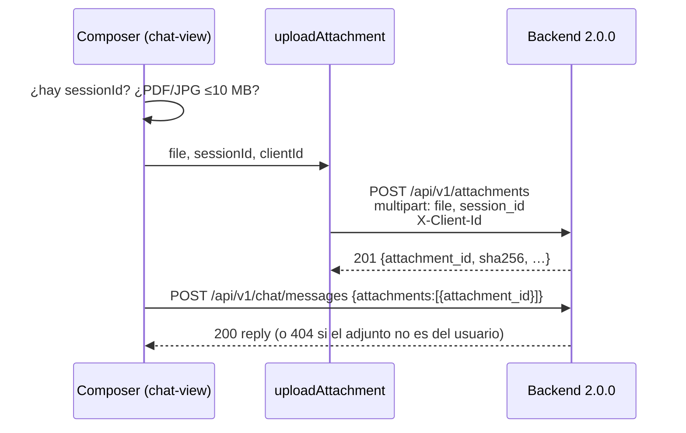

# 02 — Adjuntos del chat

| | |
|---|---|
| Frontend | `AnthonyCod/front-kodotakai@0d09a44` (`main`) |
| Backend | 2.0.0 (`feef68d`) |

## A. Estado actual del frontend

| Pieza | Archivo y líneas | Qué hace |
|---|---|---|
| Botón de adjuntar | `src/features/chat/components/chat-view.tsx:235-252` (`attach`) | Valida tipo y tamaño, llama a `uploadAttachment(file)` (línea 244) y luego `onSend(text, { attachments: [{ attachment_id }] })` |
| Cliente HTTP | `src/features/pqrs/api/pqrs-api.ts:12-17` (`uploadAttachment`) | `FormData` con `file` y, si se pasa, `declared_doc_code`. **No envía `session_id` ni `X-Client-Id`** |
| Schema de respuesta | `pqrs-api.ts:5-9` (`attachmentUploadSchema`) | `attachment_id`, `mime_type` y `size_bytes` |
| Límites en el cliente | `src/features/pqrs/api/pqrs-blocks.ts:40-43` (`ATTACHMENT_LIMITS`) | `application/pdf` o `image/jpeg` (por `file.type`), 10 MB |
| Envío en el chat | `use-send-message.ts:79-86` | `attachments` como `AttachmentRef[]` (`{attachment_id}`) |
| Mock | `src/mocks/handlers.ts` | **No hay handler para `/attachments`**: con MSW, la petición sigue hacia la red o el *proxy* |

**Lo que funciona:** la validación previa de tipo y tamaño, y el envío del `attachment_id` en el mensaje.

**Incompleto o inexistente:**
- No se envía `session_id`.
- No se envía `X-Client-Id`.
- Se puede adjuntar antes de que exista una sesión (primer mensaje).
- No hay mock.
- No hay manejo de los 401, 404 y 429 nuevos.
- No hay descarga ni previsualización.

## B. Estado real del backend

| Aspecto | Valor (2.0.0) |
|---|---|
| Archivos | `app/main.py:403-445` (`upload_attachment`); `app/auth/dependencies.py:142` (`web_chat_user`); `app/modules/pqrs/service.py:289-321` (`AttachmentService.store`) |
| Endpoint | `POST /api/v1/attachments` |
| Formato | `multipart/form-data` |
| Campo `file` | Obligatorio |
| Campo `session_id` | **Obligatorio**, UUID, en el **formulario** (no en la *query*). Debe ser una conversación `WEB_CHAT` del mismo usuario |
| Campo `declared_doc_code` | Opcional, enum `DocumentoCodigo` |
| Cabecera `X-Client-Id` | **Obligatoria**, UUID. El mismo `client_id` de `POST /chat/messages` |
| Respuesta 201 | `AttachmentUploadResponse {attachment_id, kind: IMAGE\|DOCUMENT, mime_type, size_bytes, declared_doc_code, sha256}` |

**Errores:**

| HTTP | Código | Cuándo |
|---|---|---|
| 401 | `NO_AUTENTICADO` | Sin `X-Client-Id` o con uno que no es UUID |
| 404 | `NO_ENCONTRADO` | La sesión no existe, es de otro usuario o de otro canal (`details.recurso = "session"`) |
| 413 | `CUERPO_DEMASIADO_GRANDE` | Más de 10 MiB + 64 KiB; se corta antes de leer el cuerpo |
| 422 | `VALIDACION` | Falta `session_id`, archivo vacío o de más de 10 MiB, tipo que no es PDF/JPEG por contenido, o PDF sin `%%EOF` al final (`service.py:300-305`) |
| 429 | `LIMITE_DE_TASA` | Más de 10 subidas por minuto y usuario |
| 503 | `SERVICIO_SATURADO` | El servidor está saturado |

**Reglas:**
- El tipo se detecta por **contenido**, no por `file.type`.
- El nombre original del archivo no se guarda.
- Cada subida se audita (`attachment.upload`).
- **El 429 no trae `reintentar_en_segundos`:** el limitador compartido de 2.0.0 envía `details: {"por_minuto": 10}` (`app/shared/ratelimit.py:88`).

**Asociación con el mensaje** (`POST /chat/messages`, `app/main.py:454-460`):
- `attachments: [{attachment_id, declared_doc_code?}]`;
- el backend solo acepta adjuntos **subidos por el mismo `client_id`** (`AttachmentRepository.owned_by`);
- un id ajeno o inexistente → 404 `NO_ENCONTRADO` con `details.attachment_ids`.

**Recuperación del adjunto:** **NO IMPLEMENTADO EN BACKEND 2.0.0.** No hay endpoint de descarga. La 2.1.0 (commit `b8af880`, fuera del alcance de esta auditoría) añade `GET /attachments/{id}/content` y `/link`.

## C. Matriz de integración

| Elemento | Frontend actual | Backend 2.0.0 | Diferencia | Acción necesaria |
|---|---|---|---|---|
| `session_id` | No se envía | Campo multipart obligatorio | 422 | `form.append('session_id', sessionId)` |
| `X-Client-Id` | No se envía | Obligatoria | 401 | Cabecera con `getClientId()` |
| Sesión previa | Se puede adjuntar sin sesión | Exige una sesión del usuario | 422 o 404 en el primer mensaje | Deshabilitar el adjunto hasta tener `sessionId`, o enviar antes un mensaje |
| Validación de tipo | `file.type` | Contenido (PDF completo o JPEG) | Un PDF truncado pasa en el cliente | Mostrar el `message` del 422 |
| 429 | `retryAfterSeconds` desde `reintentar_en_segundos` | `{"por_minuto": 10}` | Se usa el valor por defecto de 60 s | Aceptarlo (o que el backend unifique; ver 06) |
| Ownership en el chat | — | Valida que el adjunto sea del usuario | — | Manejar el 404 con `details.attachment_ids` |
| Mock | Ninguno | — | Con MSW no se simula | Añadir un *handler* con estas reglas |
| Descarga | No existe | No existe en 2.0.0 | — | Sin acción en 2.0.0 |

## D. Flujo de integración esperado

1. **Acción:** el usuario pulsa el clip en el chat.
2. **Inicio:** `Composer.attach(file)` en `chat-view.tsx`.
3. **Precondición:** `useChatStore.getState().sessionId` no es nulo (si lo es, se deshabilita el botón).
4. **Petición:** `uploadAttachment(file, { sessionId, clientId: getClientId() })` → `POST /api/v1/attachments`, con multipart `file` y `session_id` y la cabecera `X-Client-Id`.
5. **Validación:** `attachmentUploadSchema`.
6. **Envío:** `onSend(text, { attachments: [{ attachment_id }] })` → `POST /chat/messages` (ver 06).
7. **Errores:**

   | Error | Qué mostrar |
   |---|---|
   | 401 | Error de programación (falta la cabecera) |
   | 404 | "Tu conversación expiró, envía un mensaje e intenta de nuevo" |
   | 413 o 422 | El `message` del backend |
   | 429 | Esperar |
   | 503 | Reintentar |

8. **Resultado:** el mensaje del usuario muestra el adjunto y el bot responde.



## E. Cambios necesarios en frontend (no implementados)

| Archivo | Cambio |
|---|---|
| `src/features/pqrs/api/pqrs-api.ts` | `uploadAttachment(file, { sessionId, docCode? })`: `form.append('session_id', sessionId)` y `headers: { 'X-Client-Id': getClientId() }`. Conviene moverlo a `features/chat/api` o a `shared/api`, porque es un servicio común |
| `src/features/chat/components/chat-view.tsx:235-252` | Exigir `sessionId`; mapear los errores por `code` |
| `src/mocks/handlers.ts` | *Handler* de `POST /attachments` que exija `X-Client-Id` y `session_id` de una sesión del mismo cliente, con los mismos códigos |
| `attachmentUploadSchema` | Opcional: añadir `sha256` y `kind` |

**Riesgo:** en dev se usa el *proxy* de Vite, así que no hay CORS. Contra una URL de otro origen, el backend permite `X-Client-Id` (CORS `allow_headers`).

## F. Pruebas de aceptación

```bash
curl -s -X POST "$API/api/v1/attachments" -H "X-Client-Id: $CLIENT_ID" \
  -F "file=@factura.pdf;type=application/pdf" -F "session_id=$SESSION"
```

| Caso | Resultado esperado |
|---|---|
| Éxito | 201, y el chat acepta `attachments:[{attachment_id}]` |
| Datos inválidos: sin `session_id` | 422 |
| Datos inválidos: PNG, o PDF sin `%%EOF` | 422 |
| Datos inválidos: 11 MB | 413 o 422 |
| Sin autenticación (sin `X-Client-Id`) | 401 |
| Recurso ajeno: `session_id` de otro usuario | 404 |
| Recurso ajeno: usar en el chat el `attachment_id` de otro usuario | 404 con `details.attachment_ids` |
| Límite: 11 subidas en un minuto | La 11.ª responde 429 |
| Error de servidor | 503: botón de reintentar |

## G. Criterios de finalización

- Con `VITE_API_MOCKING=false` se sube un PDF desde el chat y el bot lo recibe.
- La petición lleva `X-Client-Id` y `session_id`.
- Un PDF truncado muestra el mensaje del backend.

## H. Dependencias y bloqueos

- Depende de **06** (sesión del chat) y de **01** (identidad `client_id`).
- La descarga y la previsualización del adjunto: **NO IMPLEMENTADO EN BACKEND 2.0.0**.
- El túnel corre hoy un backend anterior a 2.0.0, donde la subida **no** exige sesión. El frontend "funciona" ahí y fallará al publicar 2.0.0; ver 14.

## I. Conclusión

**DESCONECTADO.** La llamada apunta al endpoint correcto, pero le faltan el campo `session_id` y la cabecera `X-Client-Id`, que 2.0.0 exige. Contra el backend 2.0.0 toda subida termina en 401 o 422.
