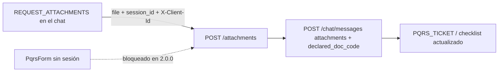

# 03 — Adjuntos de PQRS

| | |
|---|---|
| Frontend | `AnthonyCod/front-kodotakai@0d09a44` (`main`) |
| Backend | 2.0.0 (`feef68d`) |

El servicio de subida es el mismo del chat (ver **02**). Aquí solo se analiza lo que cambia en PQRS.

## A. Estado actual del frontend

Hay dos caminos distintos:

| Camino | Archivo y líneas | Qué hace |
|---|---|---|
| **Formulario directo** (`PqrsForm`, dentro de "Consultas") | `src/features/pqrs/components/pqrs-form.tsx:43-57` | Sube **un** archivo con `uploadAttachment(file, docCode)` (línea 47) y luego `createPqrsTicket({..., documentos: [{codigo, attachment_id}]})` (línea 50). **No hay conversación de chat** |
| **Desde el chat** (bloque `REQUEST_ATTACHMENTS`) | `src/features/pqrs/components/blocks/pqrs-blocks.tsx:32-47` | Por cada documento del *checklist*: `uploadAttachment(file, codigo)` (línea 39) y `sendMessage("Adjunto <codigo>", { attachments: [{attachment_id, declared_doc_code: codigo}] })` |
| Códigos | `src/features/pqrs/api/pqrs-blocks.ts:3-12` | `GUIA`, `FACTURA_COMERCIAL`, `CARTA_RECLAMACION`, `CERTIFICACION_BANCARIA`, `FOTOS_EMPAQUE`, `FOTOS_DANO`, `CEDULA_O_RUT`, `ACTA_CON_SALVEDAD` |
| *Checklist* del chat | `pqrs-blocks.ts:16-28` | `{codigo, obligatorio, recibido, descripcion}` |

**Lo que funciona:** los códigos coinciden con el enum del backend, y el bloque `REQUEST_ATTACHMENTS` coincide con `ChecklistItemDetallado`.

**Incompleto:** ninguno de los dos caminos envía `session_id` ni `X-Client-Id` (mismo defecto que 02). El formulario directo no tiene sesión que enviar.

## B. Estado real del backend

| Aspecto | Valor (2.0.0) |
|---|---|
| Endpoint de subida | El mismo `POST /api/v1/attachments` (ver 02). **No hay endpoint de adjuntos propio de PQRS** |
| Requisito de identidad | `X-Client-Id` y un `session_id` de una conversación **WEB_CHAT** del mismo usuario |
| `declared_doc_code` | Opcional en la subida (multipart) y en `AttachmentRef` del chat |
| Relación adjunto–ticket | Por `POST /api/v1/pqrs/crear-ticket` con `documentos: [{codigo, attachment_id}]` (`DocumentoAdjunto`), o por el turno de chat del flujo PQRS (bloques `REQUEST_ATTACHMENTS` y `PQRS_TICKET`) |
| Validación en `crear-ticket` | `app/modules/pqrs/service.py:197-204`: solo comprueba que el `attachment_id` **exista** (`AttachmentRepository.existing`). Si no existe: 404 `NO_ENCONTRADO` con `details.attachment_ids` |
| Autenticación de `crear-ticket` | Ninguna (público) |
| Restricción de acceso | El chat valida que el adjunto sea del usuario (`owned_by`); **`crear-ticket` no** |

**Hallazgo del backend (para el equipo de backend, no del frontend):**
- `POST /pqrs/crear-ticket` acepta cualquier `attachment_id` existente, aunque lo haya subido otra persona.
- El riesgo es bajo, porque los ids son UUID v4, pero es inconsistente con la regla de propiedad del chat.
- **Corregirlo exige decidir** qué identidad lleva el formulario directo (ver H).

## C. Matriz de integración

| Elemento | Frontend actual | Backend 2.0.0 | Diferencia | Acción necesaria |
|---|---|---|---|---|
| Subida desde el chat | Sin `session_id` ni `X-Client-Id` | Ambos obligatorios | 401 o 422 | Igual que en 02 (el bloque está dentro del chat, así que hay sesión) |
| Subida desde el formulario | Sin sesión | Exige una sesión WEB_CHAT del usuario | **Imposible** sin crear antes un chat | Decisión del backend o del producto (H) |
| `documentos` en `crear-ticket` | `[{codigo, attachment_id}]` | Igual | Compatible | Ninguna |
| `declared_doc_code` | Se envía en la subida y en el chat | Opcional en ambos | Compatible | Ninguna |
| Ownership en `crear-ticket` | — | No se valida | Hallazgo del backend | Backend |

## D. Flujo de integración esperado (camino del chat, viable hoy)

1. **Acción:** el bot muestra `REQUEST_ATTACHMENTS` y el usuario elige un archivo para `FACTURA_COMERCIAL`.
2. **Inicio:** `ChecklistItem.onFile` (`pqrs-blocks.tsx`).
3. **Petición:** `uploadAttachment(file, { sessionId, docCode: codigo })` → `POST /attachments`, con multipart `file`, `session_id` y `declared_doc_code`, y la cabecera `X-Client-Id`.
4. **Envío:** `sendMessage("Adjunto FACTURA_COMERCIAL", { attachments: [{attachment_id, declared_doc_code}] })`.
5. **Respuesta:** el backend actualiza el *checklist* y responde con `REQUEST_ATTACHMENTS` (con `recibido`) o `PQRS_TICKET`.
6. **Errores:** como en 02.

**Formulario directo:** no hay flujo viable en 2.0.0 con adjuntos. Sin adjuntos, `crear-ticket` funciona (ver 09).

## E. Cambios necesarios en frontend (no implementados)

| Archivo | Cambio |
|---|---|
| `src/features/pqrs/components/blocks/pqrs-blocks.tsx` | Pasar `sessionId` (de `useChatStore`) a `uploadAttachment` |
| `src/features/pqrs/components/pqrs-form.tsx` | Mientras no haya decisión del backend, **deshabilitar el adjunto** del formulario directo (crear el ticket sin `documentos`) o enviar al usuario al chat para adjuntar |
| `src/features/pqrs/api/pqrs-api.ts` | El mismo cambio de firma que en 02; puede reutilizarse el servicio del chat |

**Reutilización:** sí, es el mismo servicio. La única diferencia es `declared_doc_code`.

## F. Pruebas de aceptación

| Caso | Resultado esperado |
|---|---|
| Éxito (chat) | Subir la factura desde `REQUEST_ATTACHMENTS`: 201 y, tras el mensaje, `recibido: true` para ese código |
| Datos inválidos | Un JPG declarado como `FACTURA_COMERCIAL` se acepta (el código lo declara el usuario); un PNG → 422 |
| Sin autenticación | Sin `X-Client-Id` → 401 |
| Recurso ajeno | El `attachment_id` de otro usuario en el chat → 404 |
| Recurso inexistente | `crear-ticket` con un `attachment_id` inventado → 404 `NO_ENCONTRADO` con `details.attachment_ids` |
| Formulario directo con archivo | Hoy no es posible (H) |

## G. Criterios de finalización

- Desde el chat se completa el *checklist* de una reclamación con archivos reales y el ticket muestra `faltantes` vacío.
- El formulario directo no intenta subir archivos sin sesión.

## H. Dependencias y bloqueos

- **Diseño del backend 2.0.0:** todo adjunto se ata a una sesión WEB_CHAT del usuario. El formulario directo de PQRS queda **BLOQUEADO** hasta que el backend decida entre:
  - (a) que el formulario cree o use una conversación;
  - (b) aceptar adjuntos de PQRS con otra prueba de identidad.
- Ownership en `crear-ticket`: corrección pendiente en el backend.
- Depende de 02 y 06.

## I. Conclusión

| Camino | Estado | Por qué |
|---|---|---|
| Chat | **DESCONECTADO** | Mismo defecto que 02 |
| Formulario directo | **BLOQUEADO** | El backend 2.0.0 no admite adjuntos fuera de una sesión de chat del usuario |
